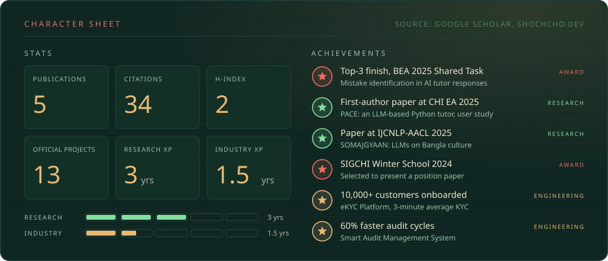

  
  
  
  

I build secure, production-grade systems for the financial sector and study how language models work. At **Bangladesh Finance PLC** I design and ship the software behind the company's move from paper to paperless. At the **Center for Computational & Data Sciences (CCDS), IUB**, I work on LLM evaluation for Bangla, AI tutoring, and educational NLP.

### Skill tree

   
   
  

Also: Hugging Face, LangChain, LlamaIndex, RAG pipelines, Oracle (DBA), Wazuh, YARA, Suricata, SIEM correlation.

### Arena

<picture>
  <source media="(prefers-color-scheme: dark)" srcset="https://raw.githubusercontent.com/Geeky-Muhtasim/Geeky-Muhtasim/output/snake-dark.svg" />
  
</picture>

<b>Experience</b>

| Role | Organization | Period |
| --- | --- | --- |
| Software Developer (Officer Grade-I), IT Division | Bangladesh Finance PLC | Sep 2025 to present |
| Research Intern | CCDS, Independent University, Bangladesh | Jan 2025 to present |
| Software Engineer (Intern) | Bangladesh Finance PLC | Apr 2025 to Aug 2025 |
| Undergraduate Researcher | CCDS, Independent University, Bangladesh | Sep 2023 to Dec 2024 |
| Junior ML Engineer (Volunteer) | Omdena Liberia Chapter | Jan 2024 to Jul 2024 |

**Education:** BSc in Computer Science and Engineering, Independent University, Bangladesh (2020 to 2024). Thesis: *PACE: Python AI Companion for Enhanced Engagement*, supervised by Dr. Amin Ahsan Ali.

<b>Publications</b>

- **SOMAJGYAAN: A Dataset for Evaluating LLMs on Bangla Culture, Social Knowledge, and Low-Resource Language Adaptation**. IJCNLP-AACL 2025.
- **Improving User Engagement and Learning Outcomes in LLM-Based Python Tutor: A Study of PACE**. CHI EA 2025. [ACM Digital Library](https://dl.acm.org/doi/10.1145/3706599.3720240)
- **BD at BEA 2025 Shared Task: MPNet Ensembles for Pedagogical Mistake Identification and Localization in AI Tutor Responses**. BEA 2025, Top-3. [ACL Anthology](https://aclanthology.org/2025.bea-1.102/) · [arXiv](https://arxiv.org/abs/2506.01817)
- **AlphaBorno at BLP-2025 Task 2: Code Generation with Structured Prompts and Execution Feedback**. BLP-2025, IJCNLP-AACL 2025.
- **Fruit Quality Detection and Monitoring System**. IEEE ICCSCE 2023. [IEEE Xplore](https://ieeexplore.ieee.org/document/10237165/)

Cards are custom SVGs in the palette of <a href="https://www.shochcho.dev">shochcho.dev</a>. The arena and the snake redraw themselves every day from live GitHub data (<a href=".github/workflows/arena.yml">workflow</a>).
